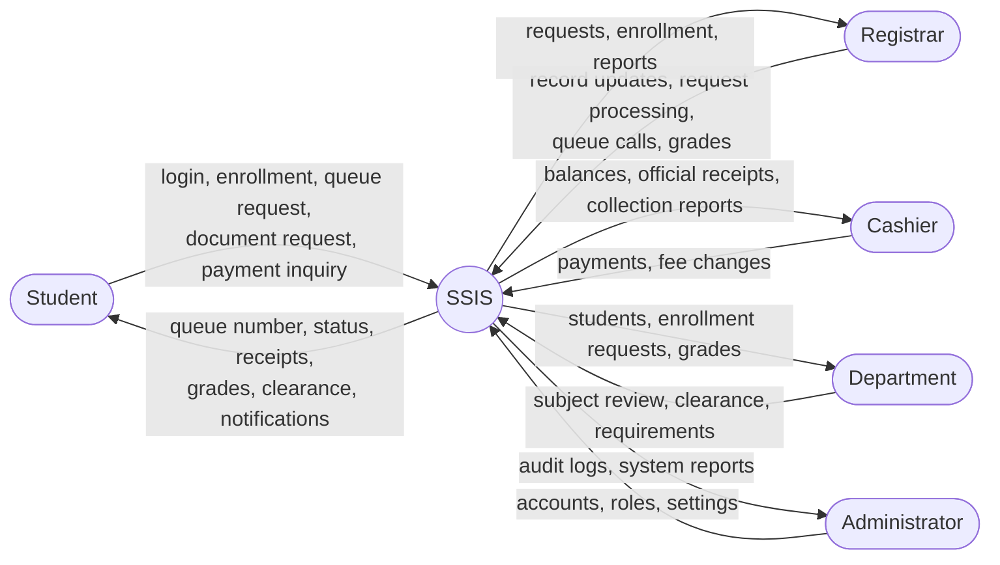
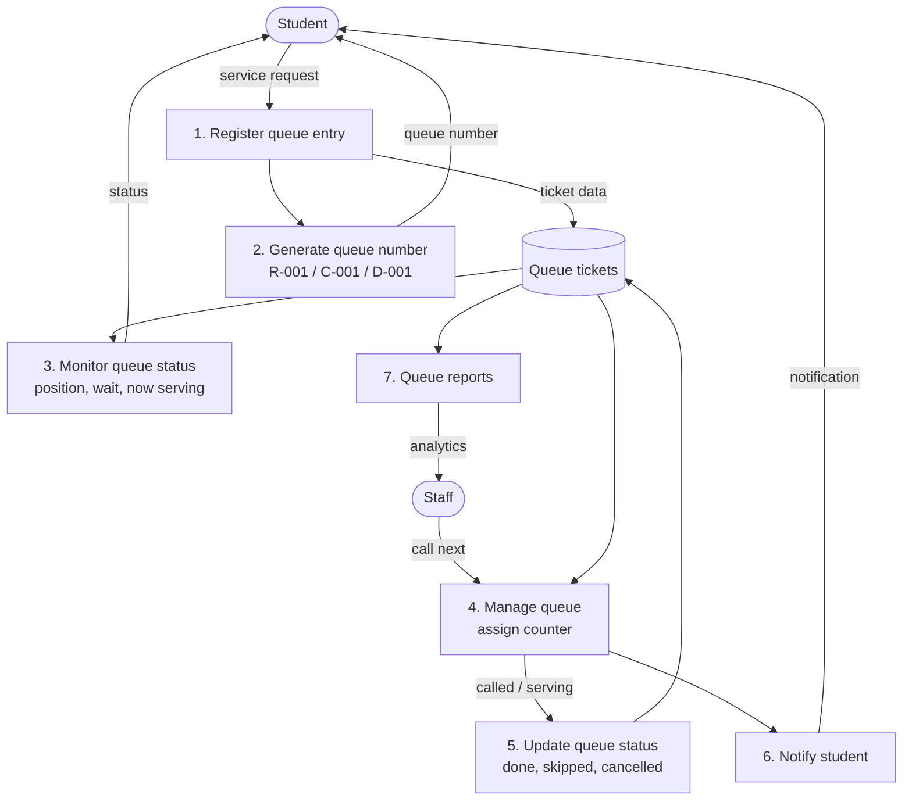
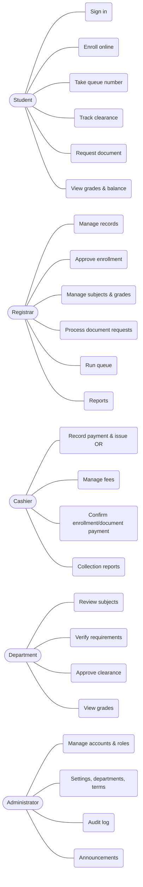
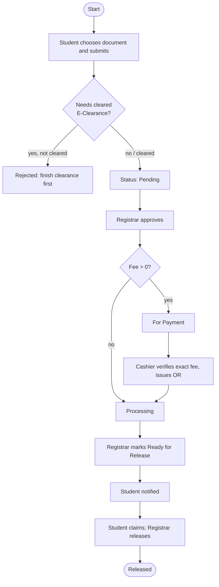
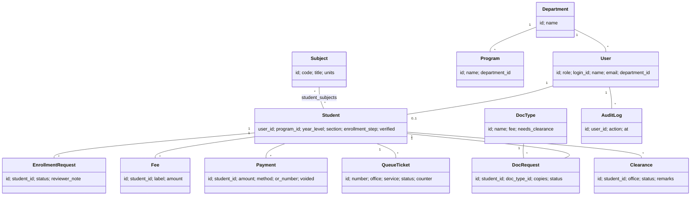
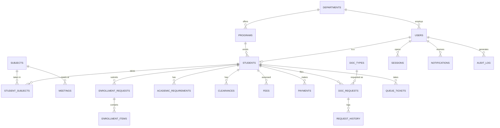

# 8. System models

Diagrams are written in [Mermaid](https://mermaid.js.org), which GitHub renders directly. The team can redraw them in draw.io or Lucidchart for the paper. These are drafts based on the implemented system; the team should review them.

## 8.1 Context-level data flow diagram

## 8.2 Level-1 DFD — digital queue

## 8.3 Use case diagram

## 8.4 Activity diagram — document request

## 8.5 Class diagram (main entities)

## 8.6 Entity-relationship diagram

## 8.7 Normalisation to 3NF (notes for the paper)

Actual tables: `departments, programs, users, sessions, settings, terms, students, year_progress, subjects, meetings, student_subjects, enrollment_requests, enrollment_items, academic_requirements, announcements, clearances, fees, payments, doc_types, doc_requests, request_history, queue_tickets, audit_log, notifications` (plus LMS-only `activities, tasks, task_messages, thread_reads`).

- **1NF:** every column holds one value; repeating groups (a student's subjects, a request's status changes) live in their own rows (`student_subjects`, `request_history`).
- **2NF:** in link tables such as `student_subjects (student_id, subject_id, term_id)` every other column (the three grades) depends on the whole key.
- **3NF:** no non-key column depends on another non-key column. Department names live only in `departments`; a program points to its department by id; document fee lives in `doc_types`, not repeated on each request; balances are not stored but computed from `fees` and `payments`, so they cannot drift.

Example of removing a transitive dependency: storing `department_name` on `students` would depend on `program_id` → `department_id`. It was instead kept only in `departments`.
